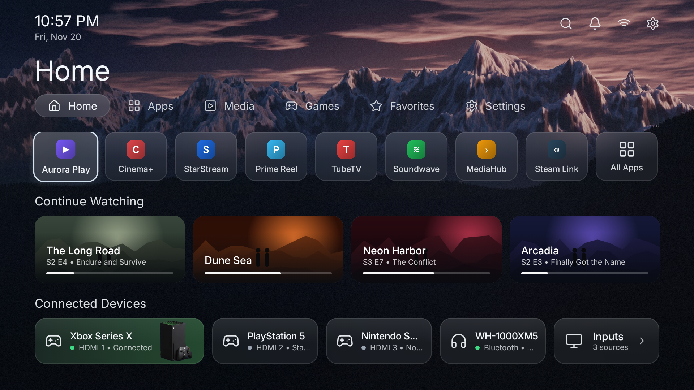
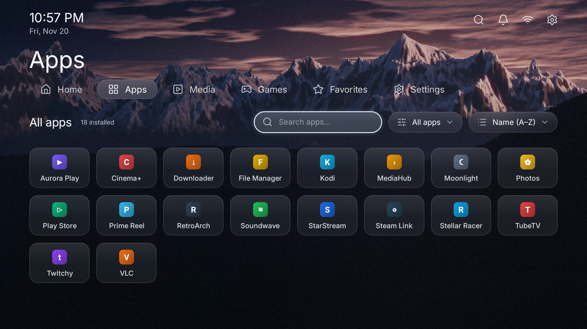

# Aether TV

A premium, minimalist, cinematic-glass launcher for **Android TV, Google TV and Android-based Fire TV**.
Native Kotlin + Jetpack Compose. No ads, no analytics, no root.

| Home | Apps |
|---|---|
|  |  |
| **Favorites** | **Settings** |
|  |  |

*Screenshots are rendered from the real app code at 1920×1080 (the TV UI resolution) with demo data: neutral demo
apps, original artwork, and simulated input/media states. See `docs/screenshots/` for Media, Games, light theme,
overlays.*

> **Read [KNOWN_LIMITATIONS.md](KNOWN_LIMITATIONS.md) first.** Fire OS does not allow third-party apps to replace the
> Home screen or to switch HDMI inputs through an official API. Aether works within those limits and says so in the UI.

## What's new in 1.1.0
See [CHANGELOG.md](CHANGELOG.md): Home button support on Fire TV, Continue Watching from apps such as Nuvio (Android TV
Watch Next), weather next to the clock, white app logos in a glass dock, much smoother Settings and tab switching.

## What you get
- Home with favorite apps, Continue Watching (Plex / Jellyfin / Kodi / any app's live media session) and Connected
  Devices (HDMI consoles incl. **Xbox Series X**, Bluetooth headphones, controllers) with honest status.
- Apps library: search, sort, filters, categories, hidden apps, rename, icon overrides, grid or list.
- Favorites dashboard for apps, games, HDMI inputs, devices, system screens and media.
- Games page split into *Play on this TV*, *Stream* and *Consoles* (HDMI).
- Settings: appearance (wallpaper, theme, accent, glass opacity, blur, dim, radius, borders, focus glow and zoom, icon
  size, typography, motion), home layout, behavior, applications, devices, TV & system shortcuts, integrations,
  profiles with PINs, backup/restore, diagnostics.
- Everything works with a TV remote: D-pad, OK, Back, long-press OK or the ☰ Menu key for options.

## Install on the Toshiba M450 / Fire TV

1. **Check the OS.** *Settings ▸ My Fire TV ▸ About*. It must be **Fire OS** (Android-based). Vega OS devices can't
   install APKs.
2. **Enable developer options.** *Settings ▸ My Fire TV ▸ About*, then click the device name 7 times. Then in
   *Developer options*, turn on **ADB debugging** and **Apps from Unknown Sources** (or allow your installer app).
3. **Install**, using one of the two methods below.

### Option A — ADB from a computer
```bash
adb connect <TV-IP-address>:5555
```
```bash
adb install -r app-release.apk
```
Find the IP under *Settings ▸ My Fire TV ▸ About ▸ Network*. Accept the debugging prompt on the TV.

### Option B — the Downloader app
Host the APK on your network or a URL you control, open Downloader on the TV, enter the URL and install.

### After installing
- Open **Aether TV** from *Your Apps & Channels* and move it to the front of the app row.
- Optional, recommended (one-time, via adb):
```bash
adb shell cmd notification allow_listener com.aether.tv/com.aether.tv.platform.AetherNotificationListener
```
  This enables the notifications panel and "Now playing" in Continue Watching.
- Optional: "Open Aether after boot" (Settings ▸ Behavior) needs:
```bash
adb shell appops set com.aether.tv SYSTEM_ALERT_WINDOW allow
```
- **Set up your Xbox:** Home ▸ Connected Devices ▸ *Xbox Series X* ▸ choose its TV input (or HDMI port label).
  Selecting the card then tries to switch to that input; see *Settings ▸ Advanced ▸ Recent events* if it doesn't.
- **Add a real photo of your console:** press ☰ (or hold OK) on the Xbox card ▸ *Add picture*, then either paste a
  direct link to a photo (downloaded once, kept on the TV), pick a file, or copy one to the TV and choose
  *From the TV folder*:
```bash
adb push xbox-series-x.png /sdcard/Android/data/com.aether.tv/files/devices/
```
  The Xbox Series X comes with a real photo of the console (taken from your reference screenshots). Other devices
  show their icon and status until you add a photo. To bundle a better product shot on a white background, run
  `python3 tools/cutout_product_photo.py photo.jpg app/src/main/res/drawable-nodpi/device_xbox_series_x.png`
  and rebuild.

### Android TV / Google TV
Install with `adb install -r app-release.apk`. On devices that offer a Home-app chooser, Aether can be picked as Home
(*Settings ▸ Behavior ▸ Default home app*). Otherwise launch it like any app.

## Build from source
Requirements: JDK 17+ and the Android SDK (platform 36, build-tools 36).
```bash
export ANDROID_HOME=/path/to/android-sdk
```
```bash
./gradlew :app:assembleRelease
```
Output: `app/build/outputs/apk/release/app-release.apk` (R8-minified; package `com.aether.tv`).
`./gradlew :app:assembleDebug` builds `com.aether.tv.debug`, which can sit alongside the release.

### Release signing
The release build is signed with the **debug key** so it installs anywhere for personal use. To sign with your own
key, create a keystore:
```bash
keytool -genkeypair -v -keystore aether-release.jks -alias aether -keyalg RSA -keysize 4096 -validity 10000
```
Then replace `signingConfig = signingConfigs.getByName("debug")` in `app/build.gradle.kts` with a
`signingConfigs.create("release") { … }` block that reads the path and passwords from a git-ignored
`keystore.properties`. Never commit keystores or passwords.

## Troubleshooting
| Problem | Fix |
|---|---|
| Home button goes to Amazon's screen | Expected on Fire OS (see limitations). Launch Aether from the app row. |
| Selecting a console doesn't switch input | *Settings ▸ Advanced ▸ Recent events* shows what was tried. Make sure the device has a TV input assigned (*Settings ▸ Devices*). Some Fire OS builds refuse the input service; Aether then opens Live TV/Settings. |
| A device shows "Input shortcut" | The TV didn't report that input to apps, so Aether can't verify its status. |
| Continue Watching is empty | Connect Plex/Jellyfin/Kodi in *Settings ▸ Integrations*, or grant notification access. Streaming apps don't share history. |
| A system setting shows "Not available on this TV" | The TV has no app-accessible screen for it; use the remote's ⚙ button. |
| Edges cut off | *Settings ▸ Behavior ▸ Overscan margin* or *Interface scale*. |
| Laggy on an older TV | *Settings ▸ Appearance*: Glass rendering → Flat tint, Animations → Reduced, Focus glow → 0%. |
| Icons/labels too small | *Appearance ▸ Icon size*, *Text size*. |

## Recovery and uninstall
- Aether never modifies system packages, so uninstalling restores the TV completely:
  *Settings ▸ Applications ▸ Manage Installed Applications ▸ Aether TV ▸ Uninstall*, or:
```bash
adb uninstall com.aether.tv
```
- Reset Aether's data without uninstalling:
```bash
adb shell pm clear com.aether.tv
```
- Back up first: *Settings ▸ Advanced ▸ Back up to TV storage*, then:
```bash
adb pull /sdcard/Android/data/com.aether.tv/files/backups/
```
- If Aether became the default Home on an Android TV device and you want the stock launcher back, choose it again in
  the system's Home-app setting, or uninstall Aether.

## Project docs
[ARCHITECTURE.md](ARCHITECTURE.md) · [FEATURE_MATRIX.md](FEATURE_MATRIX.md) · [KNOWN_LIMITATIONS.md](KNOWN_LIMITATIONS.md) ·
[TESTING.md](TESTING.md) · [ROADMAP.md](ROADMAP.md) · [CLAUDE.md](CLAUDE.md)

## Licenses
Apache-2.0 libraries (AndroidX, Compose, Hilt, Room, Coil, OkHttp, kotlinx). Inter font: SIL OFL 1.1
(`licenses/Inter-OFL.txt`). Icons derived from Lucide: ISC (`licenses/Lucide-LICENSE.txt`). Wallpapers are original
procedurally generated artwork (`tools/generate_wallpaper.py`). No third-party logos are bundled.
